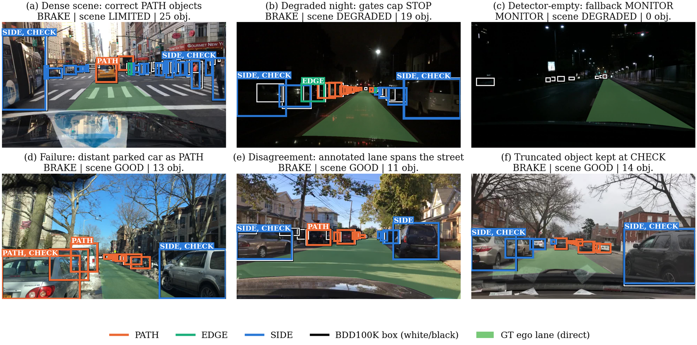
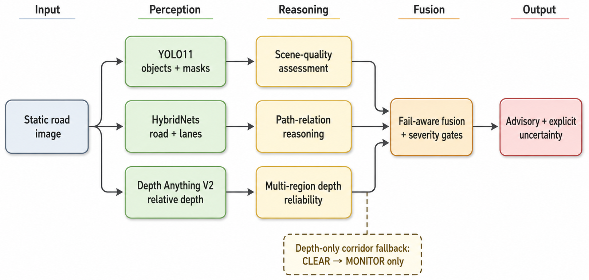
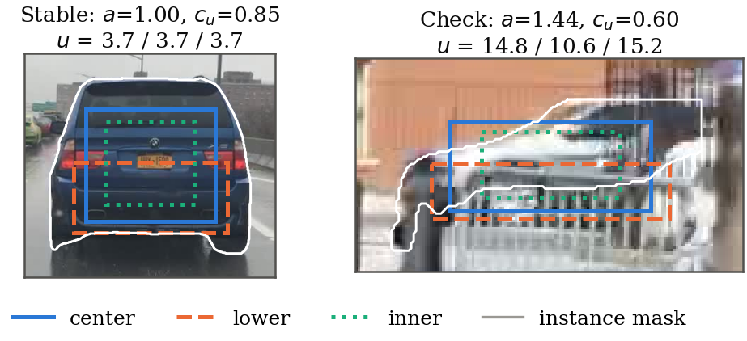
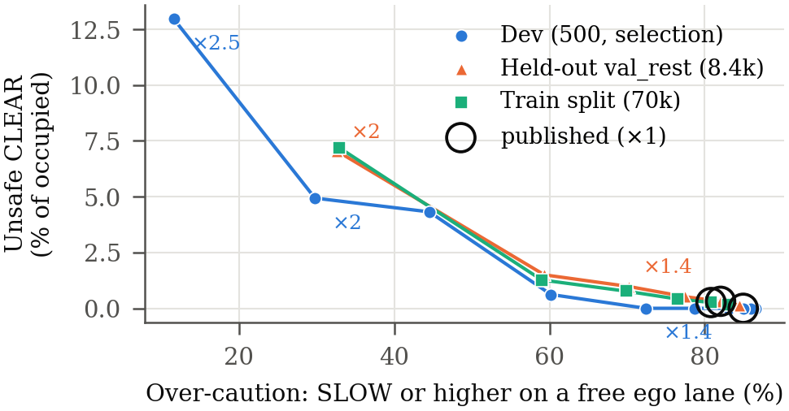
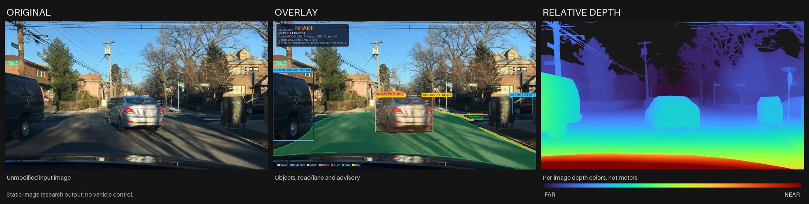
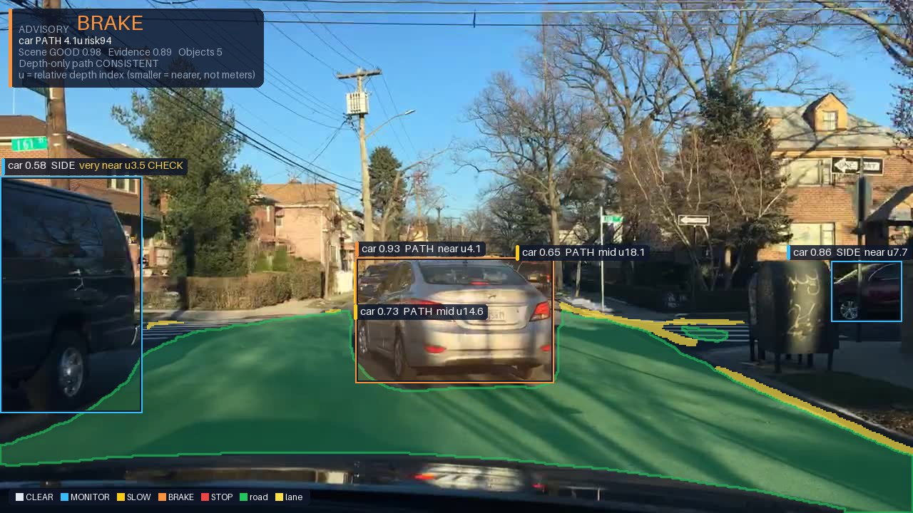
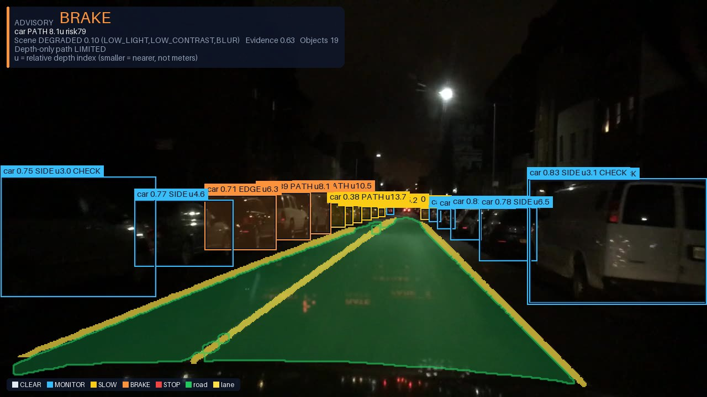
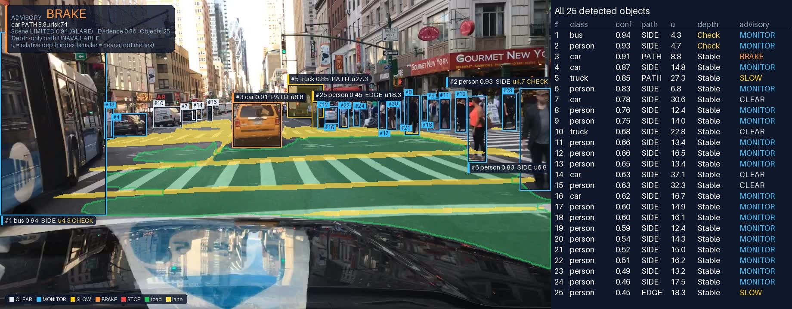
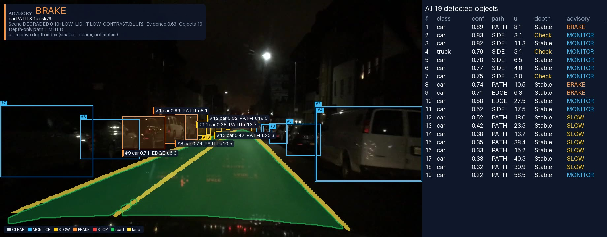

<h1 align="center">RoadScene-FailAware</h1>

<p align="center">
  <b>Conservative Road-Scene Risk Assessment via Fail-Aware Multi-Model Fusion</b><br>
  Pham Hoang Bach · Vu Gia Tien · Trinh Quang Tien · Cao Van Mai<br>
  <i>Faculty of Artificial Intelligence, FPT University · ICoCSETI 2026</i>
</p>

<p align="center">
  <a href="https://github.com/VuTien1311/roadsense-risk-assessment/actions/workflows/tests.yml"></a>
  
  
  
  
</p>

<p align="center">
  
</p>

A single front-facing image is analysed by three frozen pretrained models and an auditable,
**fail-aware fusion layer** that turns their outputs into a conservative advisory
(`CLEAR / MONITOR / SLOW / BRAKE / STOP`) with one audit record per object. Weak evidence can add
caution, but it can never create an object or justify a severe advisory.

> **Inference only.** Nothing is trained or fine-tuned here. Research code, not for vehicle control.

## Contents

- [How it works](#how-it-works)
- [Results](#results)
- [Quick start](#quick-start)
- [Reproducing the paper](#reproducing-the-paper)
- [Repository layout](#repository-layout)
- [Limitations](#limitations)
- [Citation](#citation)

## How it works

<p align="center">
  
</p>

| Component | Role | Paper profile |
|---|---|---|
| **YOLO11x-seg** | Object boxes, classes and instance masks | 960 px, confidence 0.15, four-pass TTA |
| **HybridNets-D3** | Drivable-road and lane masks for the ego corridor | 640 px |
| **Depth Anything V2 ViT-L** | Dense relative-depth field | 518 px |
| **Fusion layer** | Scene quality, depth reliability, path relation, severity gates, depth-only fallback | Relative-depth mode |

**Depth reliability.** For every object the relative depth is sampled in three regions of its
mask. When the regions agree the estimate is `STABLE`; when they disagree (for example a mask that
leaks into the background) it is kept at `CHECK` or `UNCERTAIN`.

<p align="center">
  
</p>

**Path relation and gates.** Each object is related to an ego corridor as `PATH`, `EDGE` or
`SIDE`. Severity gates then cap unsupported outputs: `STOP` needs a close, `STABLE`, in-path object
with strong detector and scene evidence. When no object is detected and the depth along the
corridor is not consistent, the fallback raises `CLEAR` to `MONITOR`.

## Results

Evaluated against BDD100K annotations on **9,500 validation images** (the validation set minus a
500-image dev subset used only for priors, sensitivity and the operating curve).

| Measure (test split) | Value |
|---|---|
| Accepted detections with a `STABLE` depth estimate | **84.9 %** |
| False positives, non-`STABLE` vs. `STABLE` estimates | 17.4 % vs. 9.7 % (**1.8x**) |
| Detection precision / recall of relevant road users | 89.1 % / 78.9 % |
| Unsafe `CLEAR` (occupied ego lane, advisory `CLEAR`) | **11 of 3,250** images |
| Over-caution (`SLOW` or higher on a free ego lane) | 4,799 of 5,844 images |
| `PATH` precision / recall against the annotated ego lane | 9.2 % / 53.8 % |

The system is conservative **at a measured cost**: the fixed perspective corridor assigns many
roadside and distant objects to the path. The operating curve below scales all advisory cut-offs
together; the published setting sits at the conservative end, and a relaxation chosen on the dev
subset does not transfer to held-out images.

<p align="center">
  
</p>

Also in the paper: cumulative and leave-one-out ablations on identical network outputs, ±20 %
threshold sensitivity, stability under six mild perturbations, results by time of day and weather,
RTX 3050 vs. T4 agreement, and a supplementary run on the 69,863 annotated BDD100K train images.

## Quick start

Windows / PowerShell, Python 3.11.

```powershell
py -3.11 -m venv .venv
& .\.venv\Scripts\python.exe -m pip install -r requirements.txt
& .\.venv\Scripts\python.exe -m pip check
```

The default requirements keep the CUDA 11.8 / PyTorch 2.7.1 recipe; for CPU-only use install
`requirements-cpu.txt` (slow).

**1. Weights.** The three checkpoints are the official pretrained files of their authors and are
not stored here. One command downloads them from the original releases (about 1.5 GB) and keeps
each file only if its size and SHA-256 match the values used for the paper:

```powershell
& .\.venv\Scripts\python.exe scripts\download_weights.py
```

| File | Model | License |
|---|---|---|
| `yolo11x-seg.pt` | YOLO11x-seg (Ultralytics, COCO) | AGPL-3.0 |
| `hybrid2/weights/hybridnets.pth` | HybridNets-D3 (BDD100K) | MIT |
| `checkpoints/depth_anything_v2_vitl.pth` | Depth Anything V2 ViT-L | CC-BY-NC-4.0, non-commercial |

Sources, manual setup and notes: [docs/WEIGHTS.md](docs/WEIGHTS.md).

**2. Run.** Place images in `input/`, then double-click `RUN.bat`, or:

```powershell
& .\.venv\Scripts\python.exe run_paper.py input --output-dir outputs\paper

# One image
& .\.venv\Scripts\python.exe run_paper.py 'input\scene.jpg' --output-dir outputs\paper

# Check the profile without models, GPU or weights
& .\.venv\Scripts\python.exe run_paper.py --dry-run 'input\scene.jpg'

# Check dependencies and checkpoint hashes; no inference
& .\.venv\Scripts\python.exe run_paper.py --check
```

Use `run_paper.py`, not `test3.py` directly: the launcher fixes the paper's model profile.

**3. Outputs.** For `scene.jpg`, `outputs/paper/` receives a three-panel comparison
(original | overlay | relative depth), the separate images, the raw depth array and a JSON audit
record. Real outputs on BDD100K validation images:

<p align="center">
  
</p>

<table>
  <tr>
    <td width="50%"></td>
    <td width="50%"></td>
  </tr>
  <tr>
    <td>Daytime: the car ahead is in the <code>PATH</code> and raises <code>BRAKE</code>; parked cars are <code>SIDE</code> and stay at <code>MONITOR</code>.</td>
    <td>Night, <code>DEGRADED</code> scene: the gates keep the advisory at <code>BRAKE</code>; depth that is not <code>STABLE</code> is labeled <code>CHECK</code>.</td>
  </tr>
</table>

**Every detection, with its numbers.** With `numbered=True` each detected object carries its number
on the image, and `render_object_table` lists all of them with class, detector confidence, path
relation, relative depth index `u`, depth state and the advisory that object raised:

<p align="center">
  
</p>
<p align="center">
  
</p>

Objects without a box were not detected at all: the detector finds 78.9 % of the relevant road
users on the test split (21 of 34 in the dense street above, 10 of 12 in the night scene).

**Reading the overlay.** Each box takes the color of the advisory that object raised
(`CLEAR` grey, `MONITOR` blue, `SLOW` yellow, `BRAKE` orange, `STOP` red); objects at `SLOW` or above
are also filled. A label reads `class confidence  relation  u<index>`: `relation` is `PATH`,
`EDGE` or `SIDE`, and `u` is the relative depth index (smaller is nearer, within this image only).
When the depth estimate is not `STABLE`, its state (`CHECK` or `UNCERTAIN`) follows `u`, in amber.
In crowded scenes the most severe objects get full labels and the others a short tag (`PATH`,
`EDGE`, `SIDE`).
The card at the top left gives the global advisory, the object that decided it, the scene quality
and the depth-only corridor state. Everything shown is read from the audit record; the overlay
computes nothing.

| File | Contents |
|---|---|
| `upgraded_scene_comparison.png` | Original, overlay and relative depth side by side |
| `upgraded_scene_overlay.png` | Boxes colored by advisory, road/lane, labels and advisory card |
| `upgraded_scene_relative_depth.png` | Per-image colorized relative depth |
| `upgraded_scene_raw_depth.npy` | Unnormalized model output |
| `upgraded_scene.json` | Object-level audit record and artifact paths |

Warm colors are nearer and cool colors farther **within the same image**; they are not meters.

## Reproducing the paper

Everything in the paper is regenerated from [`camera_ready/`](camera_ready/README.md): no number
is typed by hand.

| Step | Script | What it does |
|---|---|---|
| 1 | `harness.py infer` | Runs the unmodified pipeline and caches the three model outputs per image |
| 2 | `harness.py replay` | Re-runs only the fusion stage for each ablation, on identical network outputs |
| 3 | `gt_eval.py` | Scores a run against the BDD100K boxes, flags and drivable-area maps |
| 4 | `results.py` | Aggregates with Wilson intervals, image-cluster bootstrap and exact McNemar tests |
| 5 | `make_tables.py`, `figures.py`, `paper_numbers.py` | Tables, figures and every number of the paper |

The image IDs of every split are published in `camera_ready/sets/` (dev, test, hard set, 1k subset,
val_rest, train) with their SHA-256 values in `splits_manifest.json`. BDD100K images and labels
must be obtained separately under their own terms.

```powershell
# Lightweight tests need neither model weights nor a GPU
& .\.venv\Scripts\python.exe -m unittest discover -s tests -v
& .\.venv\Scripts\python.exe scripts\check_repository.py
```

## Repository layout

```text
|-- run_paper.py                  # Fixed inference profile launcher
|-- test3.py                      # Fusion pipeline (unchanged since the code freeze)
|-- paper_config.json             # Explicit paper/model settings
|-- paper_visualization.py        # Original / overlay / depth rendering
|-- weights_manifest.json         # Official sources and checkpoint hashes
|-- camera_ready/                 # Ground-truth evaluation, ablations, tables, figures, ID lists
|-- static_training/              # Hard-set selection and audit helpers (no training)
|-- depth_anything_v2/            # Vendored Depth Anything V2 implementation
|-- hybrid2/                      # Vendored HybridNets implementation
|-- provenance/                   # Original fusion source, kept for the equivalence test
|-- tests/  scripts/  docs/
|-- input/                        # Your images, ignored by Git
`-- outputs/                      # Generated results, ignored by Git
```

## Limitations

- Relative depth is not calibrated distance. `STABLE` indicates internal agreement, not
  ground-truth accuracy. No speed, time-to-collision, tracking or steering safety is estimated.
- Static images only; the four-pass configuration takes seconds per image and is an offline
  analysis tool. Advisories must not drive vehicle actuators.
- The image list of the hard set used in the first submitted version was not preserved; the
  published hard set is regenerated deterministically (`static_training/select_hard_bdd100k.py`)
  and every number of the paper comes from the published splits.

## Citation

```bibtex
@inproceedings{bach2026roadscene,
  title     = {Conservative Road-Scene Risk Assessment via Fail-Aware Multi-Model Fusion},
  author    = {Pham, Hoang Bach and Vu, Gia Tien and Trinh, Quang Tien and Cao, Van Mai},
  booktitle = {Proc. 2nd Int. Conf. on Computer Sciences, Engineering, and Technology Innovation (ICoCSETI)},
  year      = {2026}
}
```

## Licenses and attribution

The contribution of this repository is the integration and the fail-aware fusion logic, not the
pretrained architectures. Upstream attribution and component licenses are preserved; see
[THIRD_PARTY_NOTICES.md](THIRD_PARTY_NOTICES.md) and [LICENSE_POLICY.md](LICENSE_POLICY.md).
No new blanket license is assigned to the combined repository. The example images in the figures
come from BDD100K and remain under its terms.
